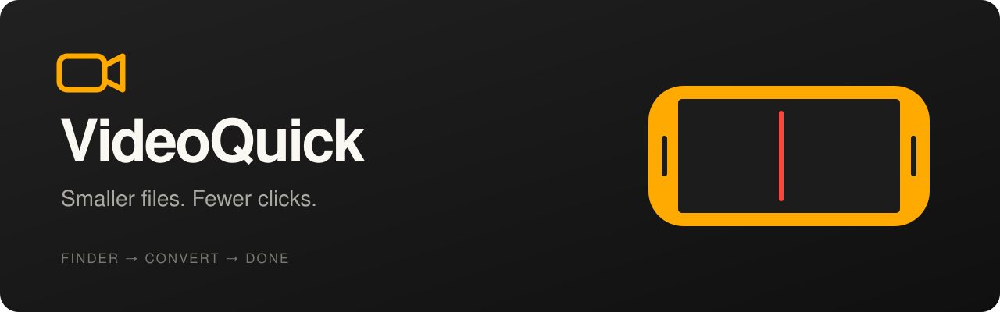

  

macOS 14+ · Apple Silicon · Native Swift · MIT <a href="README.ru.md">Русский</a> · <a href="#get-started">Installation</a> · <a href="docs/BUILDING.md">Build from source</a>

<b>A tiny video tool that lives in Finder.</b> Right-click a video, choose a bitrate, and get a lighter copy next to the original. Need a quick cut or crop? Open the editor. Keep moving.

> **Early preview:** the DMG is ad-hoc signed and has not been notarized by Apple. macOS may block opening it. See [installation and current limits](docs/INSTALL.md). The interface currently uses Russian menu labels; the editor itself is mostly icons and numbers.

### From file to finished. In a right-click.

Select one video or a whole batch in Finder. Choose **Конвертировать → 1 / 3 / 5 / 10 / 20 Mbps**. New requests join the same queue, so there is only one export at a time.

The result appears beside the original: `Forest_3mbps.mov`. Existing files stay safe; duplicate names get a number.

### A queue that stays out of the way.

One small strip. Up to 15 files per page. Segment widths reflect source file sizes; waiting files stay empty. Cancel from the single × button. No dashboard, no permanent Dock icon.

### Just enough editor.

Trim either edge, split at the playhead, remove a section, mute audio, or reframe the whole video. Drag the canvas to position it; pinch or scroll to zoom. Choose **1:1, 4:3, 16:9, 3:4, 9:16**, or resize the window freely with **auto**.

Short clips remain grabbable. Removed sections stay visible but are skipped during playback and export. Undo, redo, frame stepping, timeline zoom, and trim snapping are built in. Every save asks for a bitrate; its progress fills the timeline in the same window.

| Action | Shortcut |
| --- | --- |
| Play / pause | Space |
| Split at playhead | ⌘B |
| Delete fragment at playhead | Backspace |
| Undo / redo | ⌘Z / ⇧⌘Z |
| Step 1 / 10 frames | ← → / ⇧← ⇧→ |
| Zoom timeline | ⌘+ / ⌘− |
| Fit timeline | ⌘0 |

### See what you saved.

Open the app to see the last 30 days of actions, with actual file sizes, space saved, and export time. Double-click a row to reopen its original in the editor. History records are retained; the 30-day limit applies to the window.

### Native, local, small.

- **SwiftUI + AppKit + AVFoundation.** No Electron, no bundled FFmpeg.
- **On your Mac.** No account, uploads, analytics, or cloud conversion.
- **Originals stay original.** Outputs use separate, collision-safe filenames.
- **Memory-only previews.** No growing disk cache of saved frames.

### Get started

1. [Download VideoQuick for Apple Silicon](https://github.com/volodyatoxic/videoquick-macos/releases/download/v0.1.0/VideoQuick-0.1.0-arm64.dmg).
2. Open the DMG and drag **VideoQuick** into **Applications**.
3. Open the installed app. In **VideoQuick → Настроить меню Finder…**, enable **VideoQuick Finder** in macOS extension settings if required.
4. Right-click a local MOV or MP4 in Finder. Choose **Конвертировать** to convert, or **Изменить…** to edit.

[Installation details](docs/INSTALL.md) · [Build from source](docs/BUILDING.md) · [Report an issue](https://github.com/volodyatoxic/videoquick-macos/issues/new)

### A few honest limits

MOV and MP4 with **H.264 / HEVC, SDR, up to 8-bit** are supported. Ordinary conversion keeps the source container, codec, dimensions, orientation and audio, with checks for supported metadata and camera timecode. Editor saves deliberately discard source metadata, timecode, chapters and service tracks.

HDR, 10-bit, Dolby Vision, ProRes and unsupported track arrangements are rejected explicitly. There is no resolution selector or automatic bitrate yet. A higher bitrate can produce a larger file; the presets are targets, not guaranteed compression ratios. See [format support](docs/SUPPORT.md).

---

**License:** [MIT](LICENSE). Icons: [Feather](Resources/ThirdParty/README.md). Screenshot footage: *Big Buck Bunny*, © 2008 Blender Foundation, [CC BY 3.0](https://peach.blender.org/about/); excerpts were trimmed/transcoded for this demo. [Full credits](docs/CREDITS.md).
